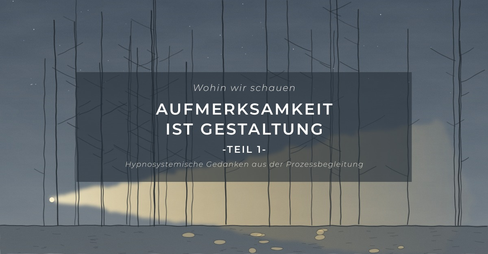
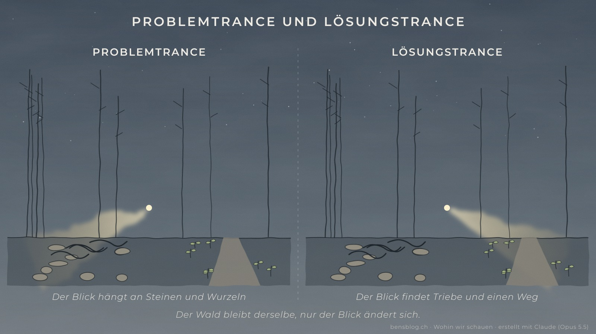

+++
title = "Aufmerksamkeit ist Gestaltung"
date = "2026-11-20"
draft = false
pinned = false
tags = ["Hypnosystemik", "Organisationsentwicklung", "Systemik", "Beratung", "Zusammenarbeit"]
image = "linkedin-post-1a-mit-titel-aufmerksamkeit-gestaltung.jpg"
description = "Wohin wir schauen, prägt, was wir für möglich halten. Über Problemtrance, eine Stirnlampe im Wald und die Frage, wo ich selbst gerade nicht hinschaue."
footnotes = "📚 **Passende Bücher**\n\n**Lehrbuch der systemischen Therapie und Beratung I**, Arist von Schlippe, Jochen Schweitzer\n\n**Einführung in die hypnosystemische Therapie und Beratung**, Gunther Schmidt\n\n**Liebesaffären zwischen Problem und Lösung**, Hypnosystemisches Arbeiten in schwierigen Kontexten, Gunther Schmidt\n\n**Wie Gefühle entstehen**, Eine neue Sicht auf unsere Emotionen, Lisa Feldman Barrett\n\n**TZI, Die Kunst sich selbst und eine Gruppe zu leiten**, Ruth C. Cohn\n\nZitate Gunther Schmidt: gehört und notiert während der Weiterbildung **Hypnosystemische Organisationsentwicklung**\n\nBilder: Erstellt mit KI (claude.ai)"
+++
***Teil 1 der Reihe «Wohin wir schauen»***


In dieser Reihe teile ich Gedanken und Erkenntnisse aus meiner Arbeit als Prozessbegleiter, Berater und Moderator, und zwar aus hypnosystemischer Sicht. Damit beschäftige ich mich zurzeit vertieft in einer Weiterbildung. Der Begriff «hypnosystemisch» stammt von Gunther Schmidt: Sein Ansatz verbindet systemisches Denken (wir sind immer Teil von Beziehungen und Kontexten, und vieles entsteht in Wechselwirkungen) mit der Hypnotherapie nach Milton Erickson (unsere Aufmerksamkeit prägt, wie wir erleben, und vieles geschieht unwillkürlich).

**\#1** [Aufmerksamkeit ist Gestaltung](https://www.bensblog.ch/aufmerksamkeit-gestaltung/)

**\#2** [Gelingensfokus braucht einen Rahmen](https://www.bensblog.ch/gelingensfokus-rahmen/)

**\#3** [Verhalten als Lösungsversuch lesen](https://www.bensblog.ch/verhalten-loesungsversuch/)

**\#4** Klarheit über das Verhandelbare entlastet

**\#5** Halten statt lösen


Es gibt Muster, die kenne ich gut. Und trotzdem tauchen sie immer wieder auf, auch nach Jahren der Beschäftigung damit. Eines davon: Mein Blick bleibt an dem hängen, was nicht funktioniert (hat), was fehlt, was schwierig ist (oder werden könnte). Oft merke ich das zuerst gar nicht im Kopf, sondern im Körper. Etwas (zum Beispiel meine Atmung) wird schwerer und enger. Ich vermute, das ist zutiefst menschlich (und ganz bestimmt nichts, was nur mir passiert). Als Berater, Prozessbegleiter, Moderator oder Organisationsentwickler (die Bezeichnung wechselt je nach Kontext, die Frage bleibt) beschäftigt es mich aber besonders. Denn wohin ich schaue, prägt mit, was im Raum möglich wird. In dieser kleinen Reihe gehe ich deshalb einer Frage nach: Wie sehr bestimmt das, worauf wir unsere Aufmerksamkeit lenken, was wir überhaupt für möglich halten?

Vorweg: Es geht mir nicht darum, Probleme schönzureden oder alles «positiv» zu sehen. Mich interessiert etwas anderes. Ein Blick auf das Gelingende entsteht nicht einfach aus guter Absicht. Er braucht einen Rahmen. Und wenn die Aufmerksamkeit zurück ins Problem kippt, ist das (vielleicht) kein Rückschlag, sondern eine Information. Darum geht es in den nächsten Teilen. In diesem ersten Teil beginne ich beim Hinschauen selbst.

## Was besprochen wird, wird grösser

Stellen wir uns eine Runde vor, die mit der Frage beginnt: «Was läuft gerade nicht gut?» Die Liste wird (meist) schnell länger. Ein Punkt erinnert an den nächsten, Beispiele kommen dazu und die Stimmung wird schwerer oder angespannter. Nach einer halben Stunde scheint fast alles schwierig. Und nun stellen wir uns dieselbe Runde vor, mit denselben Menschen und derselben Lage, aber mit einer anderen ersten Frage: «Was hat in letzter Zeit trotz allem funktioniert?» Es ist ziemlich wahrscheinlich, dass ein ganz anderer Raum entsteht. Nicht, weil die Probleme verschwunden wären, sondern weil etwas anderes Platz bekommt.

Gunther Schmidt beschreibt das mit dem Begriff **Aufmerksamkeitsfokus**: Wir erleben die Welt so, wie wir hinschauen. Was im Fokus ist, wird deutlicher, grösser und wichtiger. Was ausserhalb liegt, ist trotzdem da, nur eben im Dunkeln. Die Aussage aus einem unserer Weiterbildungstage passt gut dazu:

> «Das Erleben oder die Wirklichkeit wird jede Sekunde neu erzeugt – durch Aufmerksamkeitsfokussierung.»
>
> *Gunther Schmidt*

Ein Bild, das mir dazu hilft: eine Stirnlampe im nächtlichen Wald. Was im Lichtkegel liegt, sehe ich klar, jede Wurzel, jeden Stein. Der Rest des Waldes ist nicht weg. Ich sehe ihn nur gerade nicht.

Bleibt die Aufmerksamkeit lange am Schwierigen hängen, spricht Gunther von **Problemtrance**. Das Wort «Trance» klingt vielleicht nach Bühne und Hypnose-Show. Gemeint ist aber etwas sehr Alltägliches: ein Zustand, in dem unsere Aufmerksamkeit so stark auf etwas gerichtet ist, dass anderes kaum mehr wahrgenommen wird. Ähnlich wie beim Lesen eines spannenden Buches, wenn man nicht mehr hört, was um einen herum passiert. In der Problemtrance ist es eben das Problem, das uns so einnimmt.

Und sie zeigt sich nicht nur in Gedanken. Für ihn gehören zu einem Muster ebenso Gefühle, innere Bilder und Körperempfindungen. Vielleicht spüre ich deshalb so oft zuerst im Körper, dass ich gerade in eine Problemtrance gerutscht bin.

> «Innere Kämpfe wirken sich auf den Körper aus, das erschafft Wirklichkeit.»
>
> *Gunther Schmidt*

Was ich daran entlastend finde: Wer ständig auf Mängel schaut, erlebt die Welt als Mangel. Das ist keine Charakterfrage. Es heisst nicht, dass jemand «negativ» ist (jemand ist sowieso nicht einfach so, sondern verhält sich) oder «nicht will». Es ist eine Frage des Fokus. Und ein Fokus lässt sich verschieben.

## Was sagt mein Blick über mich?

Was mich mir immer wieder durch den Kopf geht: Meine Wahrnehmung sagt mindestens so viel über mich wie über das, was ich wahrnehme. Gunther Schmidt hat dafür ein Wort, das mir seither nicht mehr aus dem Kopf geht. Statt von Wahrnehmung spricht er lieber von *Wahrgebung*. Denn was wir erleben, bildet nicht einfach ab, wie es wirklich ist. Wir erzeugen es (zu einem guten Teil) selbst.

Wenn mir etwas als «zu viel» oder «zu wenig» erscheint, steckt darin immer auch eine Unterscheidung, die ich mitbringe. Zu viel im Vergleich wozu? Nach welchem Massstab? Und wer hat diesen Massstab festgelegt (vermutlich ich selbst oder ich habe «es» von anderen übernommen, ohne es zu merken)? Manchmal verschiebt sich mein Eindruck, sobald ich mehr weiss. Und dann wird sichtbar, dass mein erster Blick weniger eine Beobachtung war als eine Annahme.

Seither begleitet mich eine Frage, die ich mir gerne stelle (und manchmal auch ein bisschen unbequem finde): Wo schaue ich gerade nicht hin?

Es geht mir dabei nicht darum, meien Blick abzuwerten. Jeder Fokus lässt etwas aus, das ist seine Natur. Die Stirnlampe kann nicht den ganzen Wald beleuchten. Aber ich kann mir bewusst machen, dass ich gerade nur einen Ausschnitt sehe. Und ich kann den Kopf ab und zu drehen.

## Verschieben, ohne zu leugnen

Gunther betont, dass sich der Fokus bewusst verschieben lässt, ohne Probleme zu leugnen. Dieses «ohne zu leugnen» ist mir wichtig. Denn ein Blick, der das Schwierige einfach überspringt, wirkt schnell wie Wegschieben. Und was weggeschoben wird, meldet sich meistens zurück (oft lauter als vorher). In «Liebesaffären zwischen Problem und Lösung» widmet Gunther diesem Gleichgewicht einen eigenen Abschnitt: «Balance zwischen Lösungsfokussierung und Wertschätzung des ‹Problems›». Allein dieser Titel sagt für mich schon viel.

> «Die Problemreaktion wird nicht vermieden, sie wird ins Lösungsmuster eingebaut.»
>
> *Gunther Schmidt*

Wenn ich merke, dass mein Blick an einem Mangel hängen bleibt, versuche ich heute etwa Folgendes. Ein Rezept ist das nicht, eher eine Bewegung, die ich immer wieder übe:

* **Innehalten und bemerken.** Oft beginnt das im Körper: Etwas wird eng, und das ist mein erster Hinweis. Dann folgt ein inneres «Aha, da bin ich wieder.» Ohne Bewertung. Das klingt (vielleicht) banal, verändert aber schon etwas, weil ich dann nicht mehr nur *in* der Problemtrance bin, sondern sie auch ein Stück weit von aussen sehe.
* **Das Problem würdigen.** Dann lasse ich das Problem gelten. Es ist ja nicht ohne Grund da. Es will Aufmerksamkeit, und vielleicht hat es die auch verdient. Erst wenn es gesehen ist, wird es ruhiger.
* **Die Gegenfrage stellen.** Erst danach frage ich: Was funktioniert trotzdem? Wo ist es jetzt schon ein bisschen anders? Gunther sagt dazu: «Wir haben nicht das eine Leben, wir haben tausende Episoden.» Neben der Problemvergangenheit gibt es also immer auch eine Kompetenzvergangenheit, und die lässt sich für die Gegenwart nutzen. Denn, auch das ein Satz von ihm: «Die Vergangenheit prägt die Gegenwart, aber sie bestimmt sie nicht.»

Die Reihenfolge macht für mich einen Unterschied. Springe ich zu schnell zur Gegenfrage, fühlt sie sich hohl an. Nehme ich mir zuerst Zeit für das, was da ist, öffnet sich oft ganz von selbst ein Spalt für etwas anderes.

## Was bleibt?

Aufmerksamkeit ist Gestaltung. Nicht in dem Sinn, dass ich alles steuern könnte, was ich wahrnehme. Aber in dem Sinn, dass mein Fokus mitprägt, was ich für möglich halte und was in einem Raum möglich wird.

Gleichzeitig merke ich, dass ein guter Vorsatz allein selten reicht. Ein Blick auf das Gelingende trägt nur, wenn klar ist, wofür in einem bestimmten Rahmen überhaupt Platz ist. Sonst kippt die Aufmerksamkeit erstaunlich schnell zurück ins Problem. Davon handelt der nächste Teil.

Und vielleicht ist es für den Moment schon viel, zu merken, wohin ich gerade schaue. Und mich zu fragen, was daneben auch noch da ist.

Wo schaue ich gerade nicht hin?