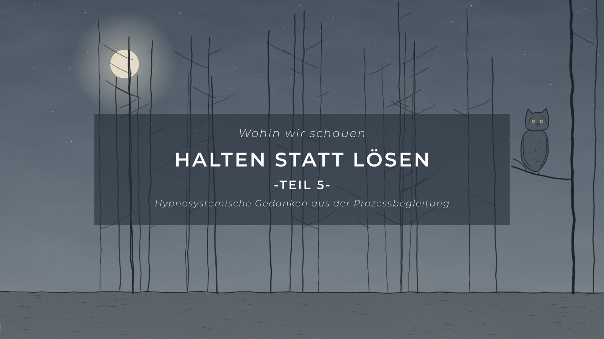
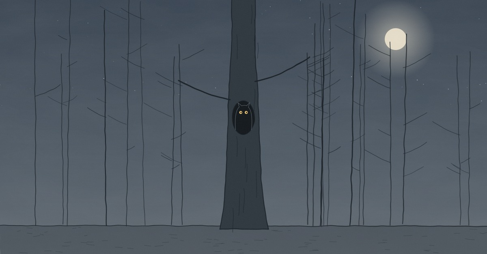

+++
title = "Halten statt lösen"
date = "2027-01-27"
draft = true
pinned = false
tags = ["Hypnosystemik", "Organisationsentwicklung", "Systemik", "Beratung", "Zusammenarbeit"]
image = "blog-titelbild-teil-5-halten-statt-loesen.jpg"
description = "Als Berater werde ich oft in die Rolle des Lösenden gedrängt (oder ist es nur ein Angebot?). Der letzte Teil der Reihe handelt von Rollenklarheit, Allparteilichkeit, einer Eule im Wald und einem Wort: Gelassenheit."
footnotes = "📚 **Passende Bücher**\n\n**Lehrbuch der systemischen Therapie und Beratung I**, Arist von Schlippe, Jochen Schweitzer\n\n**Einführung in die hypnosystemische Therapie und Beratung**, Gunther Schmidt\n\n**Liebesaffären zwischen Problem und Lösung**, Hypnosystemisches Arbeiten in schwierigen Kontexten, Gunther Schmidt\n\n**Wie Gefühle entstehen**, Eine neue Sicht auf unsere Emotionen, Lisa Feldman Barrett\n\n**TZI, Die Kunst sich selbst und eine Gruppe zu leiten**, Ruth C. Cohn\n\nZitate Gunther Schmidt: gehört und notiert während der Weiterbildung Hypnosystemische Organisationsentwicklung"
+++
***Teil 5 der Reihe «Wohin wir schauen»***


In dieser Reihe teile ich Gedanken und Erkenntnisse aus meiner Arbeit als Prozessbegleiter, Berater und Moderator, und zwar aus hypnosystemischer Sicht. Damit beschäftige ich mich zurzeit vertieft in einer Weiterbildung. Der Begriff «hypnosystemisch» stammt von Gunther Schmidt: Sein Ansatz verbindet systemisches Denken (wir sind immer Teil von Beziehungen und Kontexten, und vieles entsteht in Wechselwirkungen) mit der Hypnotherapie nach Milton Erickson (unsere Aufmerksamkeit prägt, wie wir erleben, und vieles geschieht unwillkürlich).

**\#1** Aufmerksamkeit ist Gestaltung

**\#2** Gelingensfokus braucht einen Rahmen

**\#3** Verhalten als Lösungsversuch lesen

**\#4** Klarheit über das Verhandelbare entlastet

**\#5** Halten statt lösen


Es gibt eine Spannung, die mich in meiner Arbeit (wohl) immer begleiten wird: Irgendwie werde ich, oft ganz unausgesprochen, in die Rolle des Lösenden «gedrängt». (Oder, hypnosystemisch gesehen: Vielleicht ist es einfach ein Angebot, auf das ich einsteigen kann oder nicht. Ich finde es spannend, beide Blickwinkel nebeneinander stehen zu lassen.) Das ist ja auch verständlich, denn im ersten Moment ist das, was ich anbiete, eine Dienstleistung, und wenn ich «löse», bringt das Tempo hinein (was verlockend ist, weil die Zeit begrenzt ist, in einem einzelnen Termin und manchmal auch insgesamt). Und wenn ich ehrlich bin, kommt der Druck nicht nur von aussen. Da ist auch ein Teil in mir, der gerne gut dastehen möchte, der derjenige sein will, der die Lösung bringt. Und doch weiss ich (und merke es immer wieder): Das Umsetzen ist etwas anderes, und es gehört denen, die es am Ende tragen.

### Der Sog zum Lösen

Dieser Sog ist stark, gerade dann, wenn die Zeit knapp ist. Lösungen zu liefern hätte etwas Verlockendes: Es wäre schnell und sichtbar, und ich stünde (vermutlich) gut da. Nur würde ich damit etwas übernehmen, das nicht meins ist. Inhalte und Entscheide gehören denen, die sie tragen, die damit weiterarbeiten und damit leben, wenn ich längst nicht mehr im Raum bin. Und sie bringen, so sieht es Gunther Schmidt, das Wichtigste bereits mit. In einer Weiterbildung sagte er:

> «Wer leidet oder ein Problem hat, muss Lösungswissen haben.»
>
> *Gunther Schmidt*

Darum sage ich manchmal auch ganz direkt: «Ich habe eine Idee und biete sie euch gerne an. Aber denkt daran, ihr arbeitet nachher damit. Ich bin dann wieder weg, auch wenn ich jetzt ein Teil von dem hier bin.» Überhaupt versuche ich immer wieder zu sagen, was ich tue und wie ich es tue. Schmidt meint, eine gute Beratung sei nur dann eine gute Beratung, wenn sie auch eine Weiterbildung für die Klient:innen enthält. Diese Offenheit entlastet (mich und, so hoffe ich, auch die anderen), weil klar wird, wem was gehört.

### Rahmen und Prozess halten

Mein Beitrag ist ein anderer, nämlich Rahmen und Prozess zu halten. Das klingt bescheidener, als es ist (und ist oft anspruchsvoller, als Lösungen zu liefern). Gerade in meiner Rolle gerate ich dabei immer wieder in Zwickmühlen: Was wird von mir erwartet, und in welche Richtung soll ich gehen? Schmidt sagt dazu:

> «Man kann jede Zwickmühle lösen, aber das hat seinen Preis.»
>
> *Gunther Schmidt*

Er schlägt vor, solche Zwickmühlen auf der Metaebene zu nutzen: keinen konkreten Weg vorzugeben, sondern einen Raum zu halten, und eben nicht in die Rolle des Lösenden zu gehen.

Wenn ich nach einem Bild dafür suche, kommt mir eine Eule in den Sinn, die auf einem Baum sitzt. Sie sieht den Wald von etwas weiter oben und bemerkt Bewegungen, die man unten auf dem Weg vielleicht nicht sieht. Sie kann ihren Kopf erstaunlich weit drehen und so den Blickwinkel wechseln, ohne ihren Platz verlassen zu müssen (ein bisschen wie die Stirnlampe aus dem ersten Teil, nur mit mehr Übersicht). Und sie ist im Wald oft kaum sichtbar und trotzdem da. Vielleicht ist das ein gutes Bild für das Halten: präsent sein, ohne im Mittelpunkt zu stehen.

Zum Halten gehört manchmal auch, den Plan zu verlassen. Früher hat sich das (auch) ein Stück weit wie Kontrollverlust angefühlt, gerade weil mir der Plan Sicherheit und Halt gab und gibt (davon war im dritten Teil die Rede). Und doch war es (zumindest in diesen Momenten) genau das, was die Gruppe brauchte: Raum lassen statt durchziehen.

Damit das überhaupt möglich ist, braucht es Zeit. Einen Zeitpuffer plane ich eigentlich immer ein. Wenn es aber emotional wird oder viel Spannung im Raum ist und die Zeit dann knapp wird, ist das kein guter Moment (für niemanden). Deshalb ist mir genügend Zeit grundsätzlich wichtig. Manchmal verpasse ich es trotzdem, weil ich im Voraus schlicht nicht weiss, wohin es gehen wird. Ein andermal denke ich daran und plane wirklich genügend Zeit ein, oder ich verlängere (in Absprache mit den Auftraggeber:innen) direkt im Prozess.

### Teil des Waldes

Nur ist das mit der Eule nicht ganz so einfach. Sie sitzt zwar auf ihrem Baum und sieht vieles, aber sie ist ja auch Teil des Waldes, Teil des Ökosystems. Ihr Dasein verändert etwas, ob sie will oder nicht. Genau das meint der etwas sperrige Begriff **Kybernetik zweiter Ordnung**: Ich bin als Beobachter Teil dessen, was ich beobachte. Ich stehe nicht ausserhalb und schaue auf ein System, sondern gehöre in diesem Moment dazu, und was ich sehe, hat immer auch mit mir zu tun. Schmidt sagt: «Eine Beobachtung ist immer ein Resultat einer interaktionellen Wechselwirkung.» Und an anderer Stelle: «Wechselwirkung ist Wirkung und das erzeugt Wirklichkeit.»

Dazu passt, wie er lebende Systeme versteht: Sie organisieren sich selbst, und das Erleben entsteht von innen heraus. In der Weiterbildung hat er es so formuliert:

> «Lebenssysteme funktionieren nach Wechselwirkungsprozessen in der Gegenwart, nie nach linearer Kausalität.»
>
> *Gunther Schmidt*

Menschen und Gruppen funktionieren also nicht nach dem Muster «Wenn ich A mache, passiert B». Was ich tue, wirkt, aber nicht auf berechenbare Weise.

Für mich heisst das auch, meine Hypothesen anders zu verstehen. Eine Hypothese ist im systemischen (und hypnosystemischen) Sinn eine vorläufige Annahme, die Beobachtungen miteinander verknüpft und eine mögliche Erklärung anbietet. Sie muss nicht wahr sein, sondern nützlich, oder mit Schmidt gesprochen: zieldienlich. Oder noch knapper:

> «Richtig heisst hypnosystemisch niemals wahr.»
>
> *Gunther Schmidt*

Schmidt bezeichnet sich selbst gerne als «Realitätenkellner». Er bringt seine Realitäten mit und bietet sie an, aber immer fragend, nie wissend. Dieses Bild passt für mich genau dazu, wie ich mit meinen Hypothesen (und mit meinen Lösungsideen) umgehen möchte. Sie sind Angebote und keine Wahrheiten. Ich darf sie anpassen, und manchmal muss ich sie loslassen. Das fällt mir nicht immer leicht. Ich hing auch schon an einer schönen Hypothese, die so gut zu passen schien, und musste merken, dass sie gehen durfte. Schmidt sagt, die wichtigste Kompetenz sei, «strohdumm zu werden für Antworten, aber nicht für Fragen».

Teil des Waldes zu sein heisst auch, dass ich nicht unberührt bleibe. Ich war auch schon selbst (leicht) angespannt und habe das benannt, als meine Wahrnehmung und nicht als Befund über die Gruppe. Das hat die Gruppe sichtbar bewegt. Wenn Emotionen, wie Lisa Feldman Barrett meint, Erfahrungen sind, die jeder aus der eigenen Geschichte, Physiologie und Umwelt konstruiert, dann sagt meine Anspannung vielleicht ebenso viel über mich und meinen Blick wie über das, was im Raum passiert. Und gerade deshalb kann es hilfreich sein, sie zu teilen, statt sie zu verstecken oder sie den anderen zuzuschreiben.

### Allparteilichkeit wird zugeschrieben

Teil des Waldes zu sein, hat noch eine andere Seite: Ich werde von den anderen auch als Teil davon gesehen, und manchmal als Teil einer bestimmten Seite. Damit stellt sich die Frage der **Allparteilichkeit**. Gemeint ist eine Haltung, in der ich mich nicht auf eine Seite schlage, sondern allen Beteiligten gleichermassen verbunden bleibe. Ich will das, ganz klar. Und gleichzeitig habe ich gemerkt, dass Allparteilichkeit nichts ist, was ich einfach bin. Sie wird mir zugeschrieben (oder eben nicht). Ich habe erlebt, dass ich von einzelnen Beteiligten als Verbündeter gesehen werden kann, ohne dass ich das beabsichtige.

Dazu kommt, dass es immer auch eine auftraggebende Person gibt, und die sitzt oft mit im Raum. Deshalb benenne ich die Rollen im Raum mittlerweile klar. Ich markiere meine Rolle sichtbarer, kläre sie ausdrücklicher, und ich wähle meine Sitzposition ganz bewusst (ein kleines Detail, das aber viel sagt). Und wenn ich Kontextwissen habe, bringe ich es als Angebot ein und nicht als Position.

### Was bleibt?

Am Anfang dieser Reihe stand eine These: Wohin wir die Aufmerksamkeit lenken, bestimmt, was wir für möglich halten. Ein Gelingensfokus entsteht aber nicht durch gute Absicht. Er braucht einen klaren Rahmen, und das Kippen zurück ins Problem ist eine Information, kein Rückschlag.

Beim Schreiben ist daraus so etwas wie ein Wald geworden. Da ist die Stirnlampe, die immer nur einen Ausschnitt beleuchtet, und der Bach, der ein Bett braucht und dessen Lauf ich nicht verändern kann. Da ist die Route, die Orientierung gibt, während ich doch den Weg gehe, der sich vor mir zeigt. Und da ist die Eule, die von ihrem Baum aus den Überblick hält, den Kopf dreht und doch Teil des Waldes bleibt.

Wenn mich eine Kollegin oder ein Kollege fragen würde, was ich mitgeben würde, dann wären es wohl drei Dinge: Kläre deine Rolle, früh und sichtbar. Halte deine Hypothesen locker, auch die schönen. Und benenne, was du selbst wahrnimmst, als deine Wahrnehmung und nicht als Wahrheit, und zwar ganz bewusst gewählt (nicht alles, aber manchmal gerade die eigene Resonanz oder Irritation). Ruth Cohn würde wohl von selektiver Authentizität sprechen.

Wenn ich mein Lernen in einem Wort zusammenfassen müsste, wäre es wohl **Gelassenheit**. Nicht im Sinne von Gleichgültigkeit, sondern im Sinne von: weniger lösen müssen, mehr halten können (und mir verzeihen, wenn mein Blick wieder einmal am Mangel hängen bleibt).

Wo schaue ich gerade nicht hin? Die Frage bleibt. Und vielleicht ist das gut so.