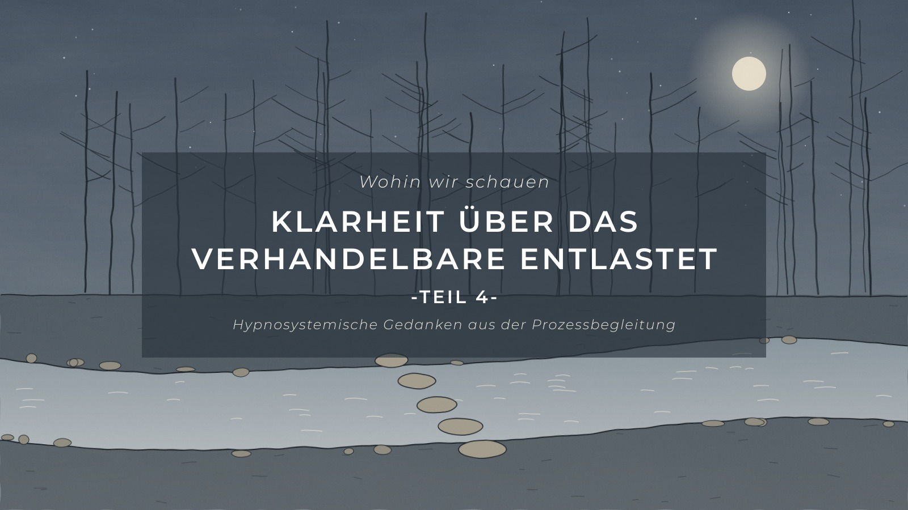

+++
title = "Klarheit über das Verhandelbare entlastet"
date = "2027-01-10"
draft = true
pinned = false
tags = ["Hypnosystemik", "Organisationsentwicklung", "Systemik", "Beratung", "Zusammenarbeit"]
image = "blog-titelbild-teil-4-klarheit-verhandelbares.jpg"
description = "Viele Diskussionen drehen sich im Kreis, weil unklar ist, ob überhaupt entschieden werden kann. Über verhandelbar, teilweise verhandelbar und nicht verhandelbar, und warum ein Rahmen auch öffnen kann."
footnotes = "📚 **Passende Bücher**\n\n**Einführung in die hypnosystemische Therapie und Beratung**, Gunther Schmidt\n\n**Liebesaffären zwischen Problem und Lösung**, Hypnosystemisches Arbeiten in schwierigen Kontexten, Gunther Schmidt\n\n**Lehrbuch der systemischen Therapie und Beratung I**, Arist von Schlippe, Jochen Schweitzer\n\nZitate und Gedanken von Gunther Schmidt: gehört und notiert während der Weiterbildung Hypnosystemische Organisationsentwicklung\n\nBilder: Erstellt mit KI (claude.ai)"
+++
***Teil 4 der Reihe «Wohin wir schauen»***


In dieser Reihe teile ich Gedanken und Erkenntnisse aus meiner Arbeit als Prozessbegleiter, Berater und Moderator, und zwar aus hypnosystemischer Sicht. Damit beschäftige ich mich zurzeit vertieft in einer Weiterbildung. Der Begriff «hypnosystemisch» stammt von Gunther Schmidt: Sein Ansatz verbindet systemisches Denken (wir sind immer Teil von Beziehungen und Kontexten, und vieles entsteht in Wechselwirkungen) mit der Hypnotherapie nach Milton Erickson (unsere Aufmerksamkeit prägt, wie wir erleben, und vieles geschieht unwillkürlich).

**\#1** Aufmerksamkeit ist Gestaltung

**\#2** Gelingensfokus braucht einen Rahmen

**\#3** Verhalten als Lösungsversuch lesen

**\#4** Klarheit über das Verhandelbare entlastet

**\#5** Halten statt lösen


Es gibt Diskussionen, die sich drehen und drehen, und je länger sie dauern, desto mehr Energie scheinen sie zu kosten (ohne dass wirklich etwas weitergeht). Irgendwann taucht dann (bei mir oder bei jemand anderem im Raum) die Frage auf, ob das, worüber wir gerade ringen, hier überhaupt entschieden werden kann, oder ob es nicht längst entschieden ist, an einem anderen Ort und von anderen. Und wenn das einmal ausgesprochen ist, passiert erstaunlich oft etwas: Es wird ruhiger, und die Aufmerksamkeit wandert (fast) wie von selbst zu dem, was die Gruppe tatsächlich beeinflussen kann.

## Ringen um das Unklare

Wenn ich auf solche Momente schaue, scheint mir, dass viel Ringen gar nicht (nur) aus Uneinigkeit entsteht, sondern aus Unklarheit. Niemand weiss so genau, ob das, worüber gesprochen wird, überhaupt zur Entscheidung steht (und solange das offen bleibt, bleibt auch die Diskussion offen, manchmal fast endlos). Mit fehlender Motivation oder fehlendem guten Willen hat das wenig zu tun. Vielleicht ringen Menschen gerade deshalb so lange, weil ihnen etwas wichtig ist.

## Verhandelbar, teilweise verhandelbar, nicht verhandelbar

Was mir hilft, ist eine einfache Dreiteilung. Manches ist **verhandelbar**, darüber kann hier gemeinsam entschieden werden. Manches ist **teilweise verhandelbar**: Der Rahmen steht, aber innerhalb davon gibt es Spielraum. Und manches ist **nicht verhandelbar**, weil es entschieden, gesetzt oder schlicht nicht beeinflussbar ist (zumindest nicht in diesem Raum).

Gunther Schmidt spricht in diesem Zusammenhang von **Restriktionen**, also von Bedingungen, die (im Moment) nicht verändert werden können. Im zweiten Teil ging es darum, was in einem Gespräch gerade Platz hat. Hier geht es um etwas Grundsätzlicheres, nämlich darum, was überhaupt entschieden werden kann. Restriktionen zu benennen heisst dabei nicht, sie gutzuheissen. Es heisst eher, sie als Teil der Wirklichkeit ernst zu nehmen, mit der wir arbeiten.

Wenn ich beim Wald bleibe, durch den sich diese Reihe zieht: Den Lauf des Bachs kann ich nicht verändern, der ist nicht verhandelbar. Wo ich ihn überquere, kann ich teilweise wählen, je nachdem, wo Steine liegen. Und wie ich danach weitergehe, ist frei (oder eben verhandelbar, wenn ich mit anderen unterwegs bin).

## Was ich heute tue

Vieles davon versuche ich (nach Möglichkeit) bereits im Auftrag zu klären: Was ist offen, was steht schon fest, und wo gibt es Spielraum? Gunther Schmidt betonte in einer Weiterbildung, dass der Sinn der Zusammenarbeit aus der angestrebten Zukunft entsteht, und dass diese Zukunft von denen definiert werden muss, die beraten werden. Erst wenn das Ziel klar ist, lässt sich sinnvoll über Probleme sprechen. Beratung ist für ihn nie Selbstzweck:

> «Jede Beratung ist ein Mittel zum Zweck und nie an sich sinnvoll.»
>
> *Gunther Schmidt*

Für mich heisst das: Wenn klar ist, wofür wir zusammenarbeiten, wird auch klarer, was hier verhandelbar ist und was nicht. Und es lohnt sich, sich für die Formulierung der Ziele Zeit zu nehmen, denn auch das sagt Gunther: «Wie Ziele formuliert werden, das hat eine bahnende Wirkung.» Sie legen also (ein Stück weit) schon den Weg, auf dem wir dann unterwegs sind.

Zu Beginn benenne ich dann, worüber in diesem Raum entschieden werden kann und worüber nicht. Manchmal ist das bereits für alle sichtbar, manchmal muss es (erst) sichtbar gemacht werden.

Nicht alles lässt sich allerdings zu Beginn klären (manches zeigt sich erst unterwegs). Wenn sich eine Diskussion im Kreis dreht, frage ich deshalb auch zwischendurch nach: Kann das hier überhaupt entschieden werden? Und wenn diejenigen im Raum sind, die darüber entscheiden können, beziehe ich sie genau an dieser Stelle ein, damit die Frage nicht in der Luft hängen bleibt.

## Ein Rahmen, der öffnet

Was mir an diesem Thema besonders wichtig ist: Klarheit begrenzt nicht nur, sie öffnet auch. Ein Rahmen wirkt auf den ersten Blick (vielleicht) einschränkend, und doch kann gerade er den Raum öffnen, sich darin frei zu bewegen. Wenn klar ist, was nicht verhandelbar ist, muss niemand mehr Energie darauf verwenden, daran zu rütteln. Und was frei ist, wird erst dann (wirklich) gestaltbar, wenn es auch als frei erkannt wird. Gunther Schmidt beschreibt lebende Systeme ganz ähnlich: Sie brauchen Begrenzung, und innerhalb dieser Begrenzung können sie ihre volle Kraft nutzen.

Vielleicht ist es wie beim Bach: Gerade weil ich weiss, dass ich seinen Lauf nicht ändern kann, kann ich mich darauf konzentrieren, eine gute Stelle zum Überqueren zu finden.

## Was bleibt?

Klarheit darüber, was verhandelbar ist, nimmt Druck aus Diskussionen und macht Spielräume nutzbar. Das klingt fast zu einfach (und vielleicht wird es gerade deshalb so leicht übersehen). Für mich ist es zu einer Frage geworden, die ich (mir) immer wieder stelle, vor einem Prozess, zu Beginn und (immer wieder) mittendrin: Was ist hier eigentlich verhandelbar?

Und es führt mich zu einer Frage, die mich durch diese ganze Reihe begleitet hat: Was ist eigentlich mein Teil in all dem? Darum geht es im letzten Teil.