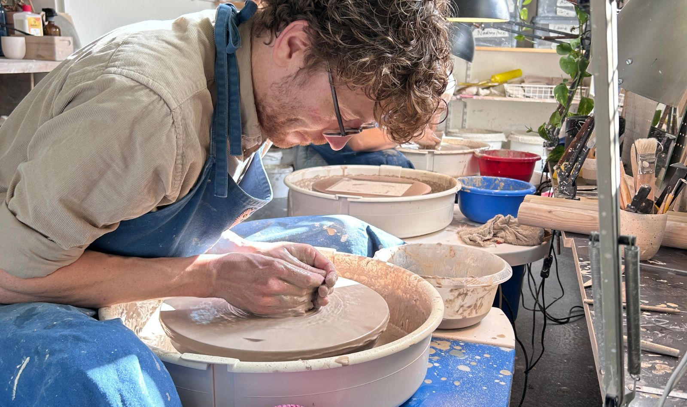
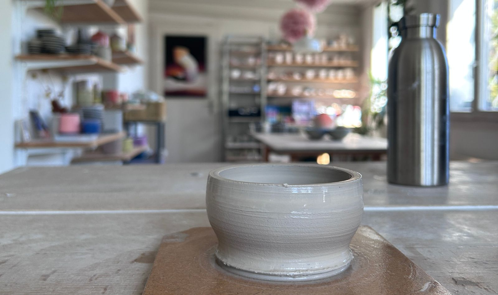
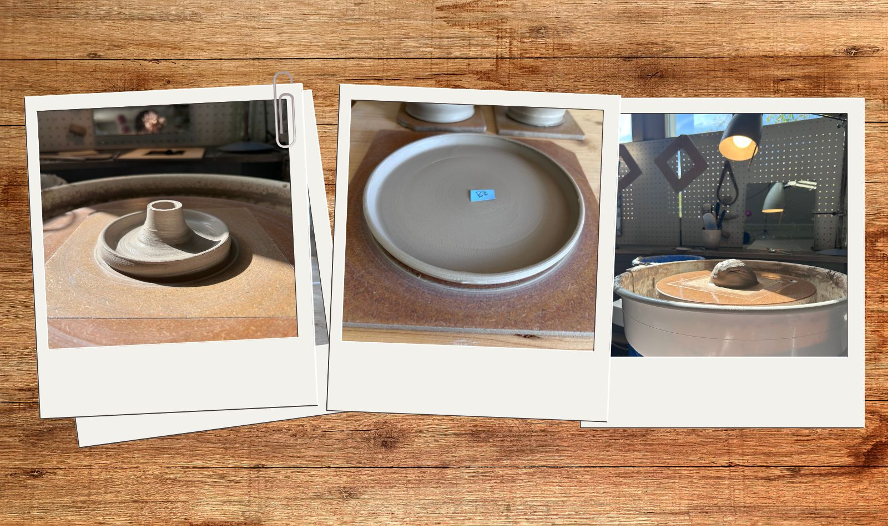
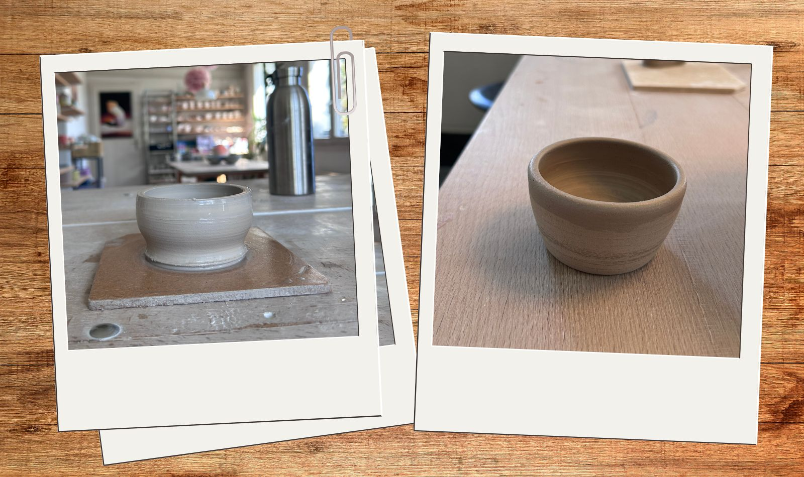
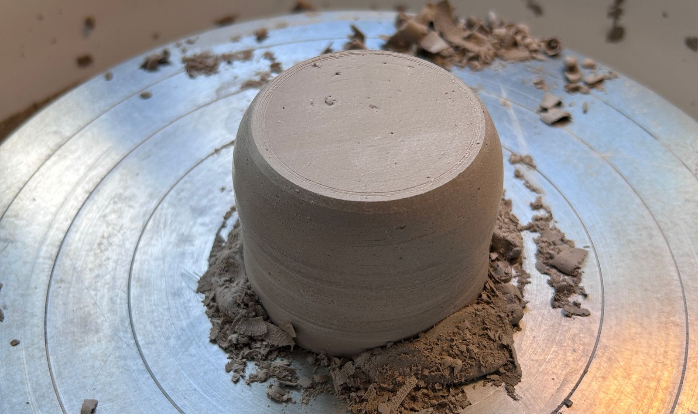
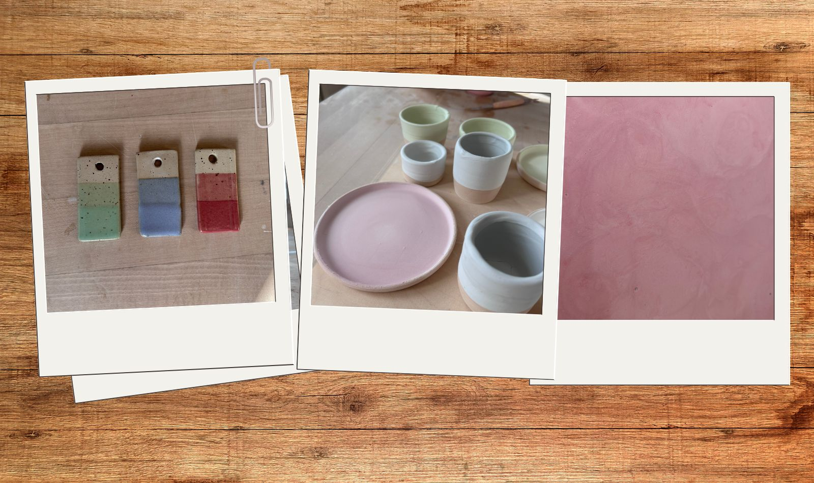
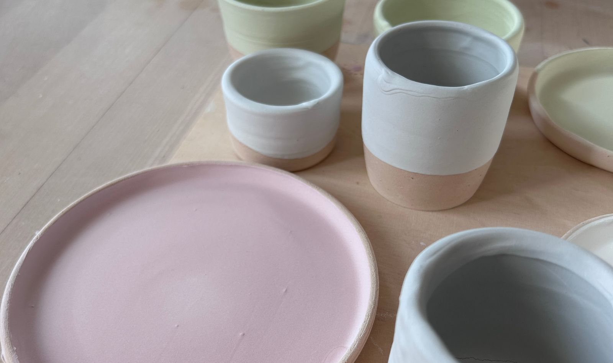

+++
title = "Töpfern – ein natürlicher Prozess"
date = "2026-10-16"
draft = false
pinned = false
tags = ["Lernen", "Gedanken"]
image = "to-pfern-ben.jpg"
description = "Was hat Töpfern mit Halten und Loslassen, Kontrolle und Vertrauen zu tun? Über das Zusammenspiel mit dem Ton, einen offenen Prozess und die Frage, was sich dabei verändert."
footnotes = "Den Kurs habe ich übrigens bei [Anina Ung Keramik ](https://www.aninaung.ch)besucht"
+++
# Töpfern – ein natürlicher Prozess

## Töpfern

Bewegung und Stabilität – so lässt sich Töpfern an der Drehscheibe vielleicht auf den Punkt bringen. Es ist aber auch Halten und Loslassen. Es ist Fühlen, sich Einlassen und mit dem gehen, was ist.

Wer bestimmt den Prozess – ich oder der Ton? Der Ton gibt mit seiner jeweiligen Beschaffenheit vieles vor und man könnte sagen, er ist es und «man» muss sich darauf einlassen, damit «es» gutkommt. Oder bin ich es, der den Rahmen gibt, die Masse in die Form bringt? Am naheliegendsten scheint mir, dass wir es beide sind, ich und der Ton. Es scheint dann zu funktionieren, wenn ich mich auf den Ton einlasse, im Moment bin und gleichzeitig die Form vorgebe – den Rahmen gebe. Es ist also das Zusammenspiel zwischen mir und der Masse, die sich auf der Scheibe dreht.

Töpfern ist ein Prozess mit ungewissem Ausgang. Jeder Arbeitsschritt kann Erfolg oder Scheitern zur Folge haben, wobei eigentlich immer eine Lernmöglichkeit drinsteckt.

Wie das Resultat am Ende aussehen wird, ist ebenfalls nicht ganz klar. Das Produkt verändert sich beim Trocknen, beim Abdrehen (dort gebe ich die Form vor), beim Glasieren und Brennen. Es ist also immer auch ein absichtsvolles Tun in eine Richtung, deren Resultat bis nach dem Brand im Ofen offen bleibt.

So habe ich den Eindruck, dass nicht nur der Tonklumpen am Ende dieser Prozesse ein anderer ist, sondern auch ich (auch wenn nur minimst). Ich spüre, beobachte, lerne, vergesse zu atmen, pendle zwischen Aufmerksamkeit, Anspannung, Aufmerksamkeit, Freude, Entspannung, Schrecken und Neugier.

## Drehen

Ich komme mit dem Ton in Kontakt, schneide mir ein Stück ab, knete, setze mich an die Drehscheibe und beginne zu zentrieren. Dafür brauche ich (so scheint es mir) Stabilität und Entspannung (oder Lockerheit) gleichzeitig. Das Zentrieren kann eine mühselige Angelegenheit sein und gleichsam befriedigend. Ich verabschiede mich vom Perfektionsanspruch und fühle mich bei «so zentriert wie im Moment möglich» wohl. Klar, dieser erste Schritt bestimmt mit, wie genau, wie gut das Endergebnis werden kann.

Anschliessend beginne ich zu formen – je nachdem, was ich machen will. Ich ziehe den Ton hoch, arbeite die Masse nach oben und achte dabei auf die Form, auf Stabilität und genügend Feuchtigkeit. Langsam bewege ich meine Hand weg (das ist zumindest das Ziel, das ich immer wieder «verfehle») vom Werkstück weg, während es weiterdreht, um Wasser aufzunehmen, die Feuchtigkeit zu halten. Meine andere Hand bleibt dort, mein Körper bleibt stabil, meine Aufmerksamkeit beim Produkt, das entstehen will.

## Abdrehen – Form und Schönheit

Ein Prozessschritt, der mich begeistert. Beim Abdrehen fliegen die Späne, das, was da ist, wird geformt, verfeinert und nimmt Gestalt an. Auch hier ist das Zentrieren die Basis von Gelingen (oder Scheitern). Ich versuche, im Körper stabil zu sein, im Kopf flexibel und bearbeite mit dem Werkzeug die Oberfläche, versuche in die Richtung meiner Vorstellung zu arbeiten und immer die Eigenschaften von dem, was da gerade dreht, zu berücksichtigen, zu respektieren und mitzugehen.

## Glasieren

Und dann, nach dem ersten Brand, kommt die Glasur. Welche Farbe passt zu welchem Gefäss und wie wird es am Ende aussehen? Hier gehe ich nach Gefühl, wähle drei Farben. Jede Farbe muss ich zuerst aufrühren, um anschliessend die Flüssigkeit in die Gefässe zu leeren, um sie gleich wieder auszuschütten, bevor ich die Aussenseite in den Kessel tunke. Und wieder bin ich begeistert, wie die Flüssigkeit schnell trocknet und sich doch noch leicht abreiben lässt – dasselbe Material, das nach dem zweiten Brand hart und unveränderbar ist.

## Nichts bleibt, wie es ist

Und dann wird alles fest und unveränderbar sein – der Ton in seiner Form, die Glasur in ihrer Farbe und beides zusammen als fertiges Produkt. Es ist, was es ist. Und wie geht es mir danach? Was hat sich in mir verändert, vielleicht auch nur minimst? Und was hat sich gefestigt und gibt es etwas, das nun unverformbar ist?

Vielleicht sind das alles etwas grosse Fragen für so einen kleinen Prozess. Sicher ist, nichts ist unveränderbar, auch diese Tongefässe nicht. Zumindest nicht, wenn sie kaputtgehen. Und auch dann werden sie vielleicht zu etwas Neuem oder anderem. Ich denke da an Kintsugi, an die Bruchstellen, die nicht versteckt, sondern sichtbar gemacht werden. Was vorher ganz war, ist danach anders. Nicht unbedingt besser oder schlechter. Einfach anders.